# 🕸️ Site Update — Hybrid Web Extraction & Orchestration Node for Android

> A mobile-first, on-device data extraction engine. It loads real web pages in a (hidden) Android WebView, runs scripted interactions, extracts exactly the data you care about, tracks changes over time, and delivers the result as a notification, a log entry, or an encrypted webhook to your own backend.


---

## 📑 Table of Contents

1. [Overview](#-overview)
2. [Why This Exists](#-why-this-exists)
3. [Feature Summary](#-feature-summary)
4. [Real-World Use Cases](#-real-world-use-cases)
5. [Architecture & Execution Pipeline](#-architecture--execution-pipeline)
6. [Feature Deep Dive](#-feature-deep-dive)
7. [UI Walkthrough](#-ui-walkthrough)
8. [Custom JavaScript Guide](#-custom-javascript-guide)
9. [Backend Integration (Webhook + Encryption)](#-backend-integration-webhook--encryption)
10. [Log Export Format](#-log-export-format)
11. [Security Model](#-security-model)
12. [Design Decisions](#-design-decisions)
13. [Known Limitations](#-known-limitations)
14. [Responsible Use](#-responsible-use)
15. [Roadmap](#-roadmap)
16. [Engineering Workflow & Role](#-engineering-workflow--role)
17. [Source Code & Contact](#-source-code--contact)

---

## 🔭 Overview

**Site Update** turns an Android phone into a small, programmable data-collection node. Instead of relying on a cloud scraper that must be hosted, paid for, and kept alive, the app runs the whole pipeline on the device:

```
Schedule → Load page → Wait → Click sequence → Extract → Clean → Compare → Notify / Log / Webhook
```

Every monitor is configured on the phone, runs in the background, and can end in any combination of:

- a native Android notification,
- an entry in a per-monitor history log (exportable as text),
- an optional **webhook / API call** whose body can be **encrypted end-to-end** (AES-256-GCM) for your own backend.

The same app handles a one-line CSS selector for a parcel tracker and a full JavaScript routine that walks a job board and returns a formatted result.

---

## 💡 Why This Exists

The project grew out of real problems hit while scraping and monitoring sites by hand:

| Problem | How the app addresses it |
|---|---|
| Pages with no API, RSS, or email alerts (courier status, government notices) | Poll the page on a schedule and notify only when the extracted value changes |
| Content rendered by JavaScript, so a plain HTTP request sees an empty shell | Render the page in a real Android WebView (hidden, in the background) before extracting |
| Content hidden behind tabs, dropdowns, or cookie banners | Scripted click sequences with a wait after each step |
| Login walls with 2FA/CAPTCHA that cannot be automated reliably | Log in once on a desktop browser, export the session cookies as JSON, and import them into the app |
| Random or changing CSS class names | Contextual extraction (anchor on a keyword, traverse to the parent) and full custom JavaScript |
| Raw HTML noise in alerts | Cleaned-text output and a notification template (`$s`) |
| Getting the data *out* of a phone into a database | Webhook with optional encrypted payload, plus plain-text log export |

---

## ✨ Feature Summary

| Area | Capability |
|---|---|
| **Extraction modes** | Matched element with parent traversal · Custom CSS selector · Custom XPath · Regular expression · Custom JavaScript |
| **Scoping** | Base element boundary (whole page or a specific node) · keyword target · numeric index for the *n*-th match |
| **Rendering** | Standard fetch · Hidden background WebView for JavaScript-heavy sites |
| **Interaction** | Ordered click sequence (CSS selectors) with a configurable wait after each click · configurable wait after page load |
| **Authentication** | Persistent auth session · JSON cookie import from a desktop browser |
| **Scheduling** | Per-monitor interval (minutes) · randomized jitter · per-monitor on/off toggle |
| **Change detection** | Stores last extracted value · trigger rules (e.g. *Contains Target*) · case-sensitivity option · duplicate-alert suppression |
| **Output cleaning** | Cleaned text output (tags removed, whitespace normalized) |
| **Notifications** | Native Android notification with a message template (`$s` = extracted text) |
| **History** | Timestamped per-monitor log · "Visit Website" shortcut · copy to clipboard · export as text |
| **Integrations** | Webhook / API call (POST, custom headers, `$s` body sent as UTF-8 text) |
| **Encryption** | Optional AES-256-GCM payload encryption (PBKDF2-HMAC-SHA256 key derivation) · in-app decryption guides for Python, Node.js, PHP |
| **Backup** | Password-protected, encrypted export and import of monitor configuration |
| **Debugging** | "Test & Download Raw HTML" to inspect exactly what the engine sees |

---

## 🎯 Real-World Use Cases

- **Package tracking**: watch the latest milestone on courier and e-commerce tracking pages (Amazon, Bluedart, local couriers) and get the newest status as a notification.
- **Job and exam notices**: monitor recruitment and exam portals (e.g. staff-selection, teacher-eligibility, and state public-service pages) for new vacancy or notification text.
- **Price watching**: track a product price and alert when the value changes or contains a target string.
- **Weather and status pages**: pull a single line (temperature, "feels like") from a page that offers no alerts.
- **Personal data pipeline**: forward each extracted value to your own API, store it in PostgreSQL, and analyze change history over time.

---

## 🏗️ Architecture & Execution Pipeline

### High-level flow of one monitor run

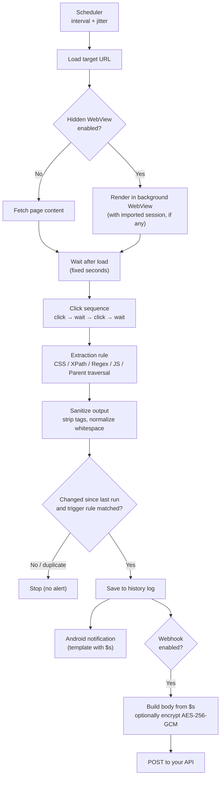

### Components

| Component | Responsibility |
|---|---|
| **Scheduler** | Runs each enabled monitor at its interval, with randomized jitter added to avoid a rigid fixed pattern |
| **Page loader** | Chooses between a standard fetch and a hidden WebView, applies saved cookies/session |
| **Interaction engine** | Applies the post-load wait, then executes the click sequence step by step |
| **Extraction engine** | Applies the chosen rule inside the configured scope and returns text |
| **Sanitizer** | Removes markup and normalizes whitespace so the payload is clean text |
| **State store** | Remembers the last extracted value per monitor for delta comparison, and keeps the history log |
| **Notifier** | Formats the message template and posts the Android notification |
| **Webhook client** | Sends the (optionally encrypted) payload to a user-defined endpoint with custom headers |
| **Crypto module** | AES-256-GCM encryption with PBKDF2-derived keys, used for payloads and backups |
| **Backup module** | Password-protected export/import of monitor configuration |

---

## 🔬 Feature Deep Dive

### 1. Four-step monitor configuration

Each monitor is defined in four logical steps:

1. **Search Scope**: choose the base element. Default is *Whole Page*, or restrict the search to a parent node (for example a specific `<table>`, `<tbody>`, or `<div>`).
2. **Search Target**: a keyword to anchor on, plus a numeric **index** to pick the *n*-th occurrence inside the scope.
3. **What to Extract**: the extraction rule and the output format (cleaned text by default).
4. **Alert Conditions**: trigger rule, case sensitivity, duplicate suppression, interval, jitter, and the notification message.

The form also offers **Keep Auth Session**, **Use Hidden WebView**, and **Test & Download Raw HTML** at the top for quick debugging.

### 2. Extraction modes

| Mode | Best for |
|---|---|
| **Matched Element (with Parent Traversal)** | Pages with random or unstable class names. Anchor on stable visible text, then walk *up* the DOM to capture the whole surrounding block |
| **Custom CSS Selector** | Stable, well-structured pages. Targets an element by what it *is*, not where it sits, so it survives layout shifts |
| **Custom XPath** | Structural queries that CSS cannot express |
| **Regular Expression** | Pulling a pattern (price, ID, date) out of text |
| **JavaScript Code** | Anything dynamic: iterate nodes, combine fields, clean text, apply logic, and return a pre-formatted string |

### 3. Hierarchical scoping and indexing

Selector ambiguity is a common cause of wrong data on busy pages. Setting a strict **parent boundary** limits the engine to one region of the DOM, and the **index** selects exactly which occurrence to use, for example the third match inside a given table.

### 4. Click sequences and timing

Many pages only reveal data after an interaction. Each monitor can define:

- **Wait after page load** (seconds) so the page can finish rendering.
- An ordered **click sequence**: each step is a CSS selector plus a wait time (seconds). Steps run in order, each followed by its own wait, then extraction starts.

Waits are deliberately **strict durations**, not "wait until visible" (see [Design Decisions](#-design-decisions)).

### 5. Hidden WebView and authenticated sessions

- **Hidden background WebView**: for JavaScript-driven sites, the app creates an invisible Android WebView inside a background service, lets the page render and run its scripts, then runs the extraction.
- **Keep Auth Session**: preserves the logged-in state between runs for sites that require login.
- **JSON session import**: log in on a desktop browser (handling 2FA/CAPTCHA there), export the cookies as a JSON array, and paste them into the app. The WebView starts already authenticated, with no brittle automated login flow.

### 6. Scheduling and jitter

- **Interval (min)**: base time between runs.
- **Jitter (min)**: a random offset added to each run, so requests do not land at perfectly regular moments and a fleet of monitors does not fire simultaneously.
- Each monitor has an independent on/off toggle on the dashboard.

### 7. Change detection and alert conditions

- **Stateful delta tracking**: the last extracted value is stored per monitor and compared on every run.
- **Trigger rule**: for example *Contains Target*, with an optional **case-sensitive** switch.
- **Ignore duplicate alerts**: if the value has not changed, no notification is sent. This also prevents repeated alerts for an unchanged message.

### 8. Notification templating

The **Notification Message** field accepts free text plus the `$s` placeholder, which is replaced with the cleaned extracted text. For example:

```
Parcel update: $s
```

### 9. History log and export

- Every detected change is stored with a timestamp in a per-monitor **history dialog** (with a **Visit Website** shortcut and copy-to-clipboard).
- The log can be **exported as plain text** (format documented [below](#-log-export-format)). The export is intentionally raw; encrypt it separately if you need to share it.

### 10. Webhook / API call

Enable **Trigger Webhook / API Call** on a monitor to forward each detected change:

| Field | Description |
|---|---|
| **API URL (POST)** | Endpoint that receives the data |
| **Headers** | One `Key: Value` per line (for example `Authorization`, `X-Monitor`) |
| **Payload / Body** | Template; `$s` is replaced by the extracted text. Sent as **plain UTF-8 text** |
| **Encrypt Payload** | Optional AES-256-GCM encryption (see below) |

Sending the body as plain text means no character in the extracted value can break a JSON structure.

### 11. Payload encryption

When **Encrypt Payload** is enabled, the body is encrypted before it leaves the device.

| Parameter | Value |
|---|---|
| Cipher | AES-256-GCM (authenticated encryption) |
| Key derivation | PBKDF2-HMAC-SHA256, 10,000 iterations, 32-byte key |
| Salt / nonce | Random, generated for every payload |
| Wire format | `Base64(Salt)]Base64(Nonce)]Base64(Ciphertext+Tag)` |
| Transport | Sent as text; the backend treats it as a base64 string |

The receiver needs the **same passphrase** to decrypt. An in-app **Decryption Guides** screen provides ready-to-copy snippets for Python, Node.js, and PHP.

### 12. Encrypted backup (export / import)

- **Export** asks for a password and writes an encrypted file.
- **Import** requires the exact same password; a wrong password or a modified file fails authentication and nothing is imported.

---

## 📸 UI Walkthrough

### 1. Main Orchestration Dashboard
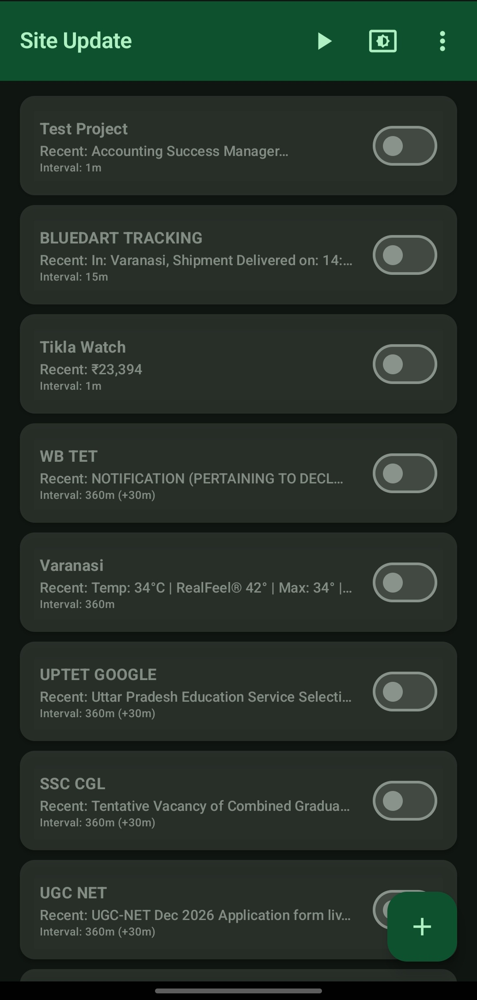<br>
The central hub. Lists every monitor with its name, most recent extracted value, interval, and an on/off toggle, plus a button to add a new monitor.

### 2. Task Initialization
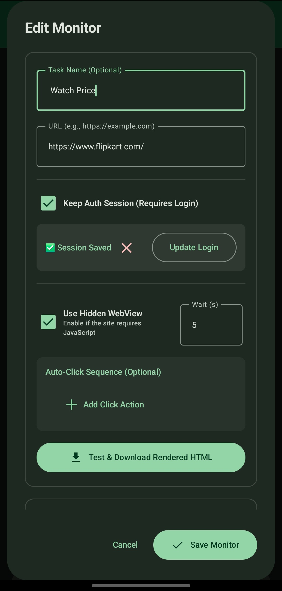<br>
Entry point for a new pipeline: task name, target URL, auth-session and hidden-WebView options, and a **Test & Download Raw HTML** button to inspect what the engine receives.

### 3. Multi-Modal Extraction Rules
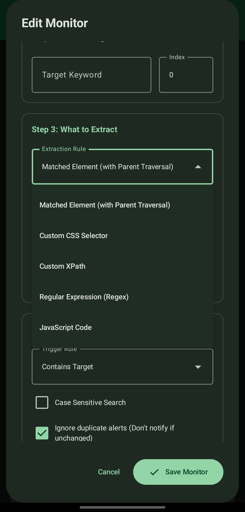<br>
The extraction-rule dropdown: parent traversal, custom CSS selector, custom XPath, regular expression, or JavaScript code.

### 4. Granular Searching Scope
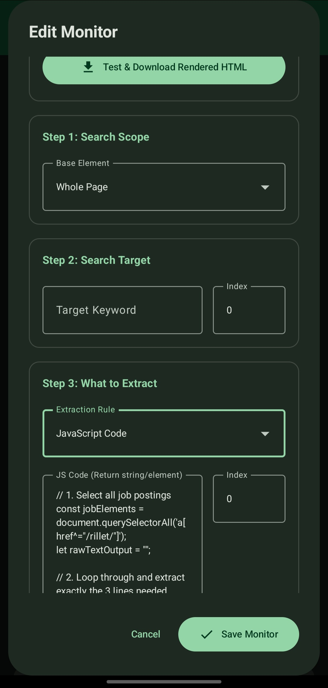<br>
Restrict the search to a specific parent node to remove ambiguity on busy, deeply nested pages.

### 5. Advanced JavaScript Injection
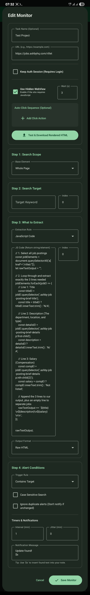<br>
Inject a custom JavaScript routine that iterates nodes, extracts nested elements, and returns a clean, pre-formatted string.

### 6. Auto-Click Sequences
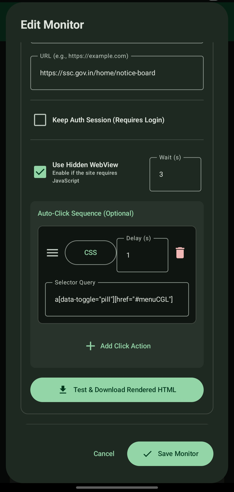<br>
Define ordered clicks (CSS selectors) with a wait after each, so the page reaches the right state before extraction.

### 7. Alert Conditions, Jitter & Scheduling
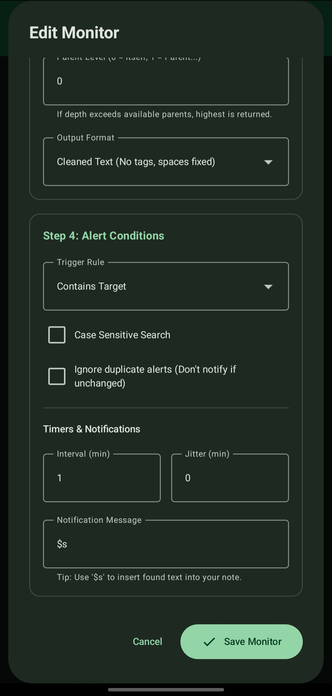<br>
Base interval, jitter, trigger rule, duplicate suppression, and the notification template using `$s`.

### 8. Cross-Environment Session Import
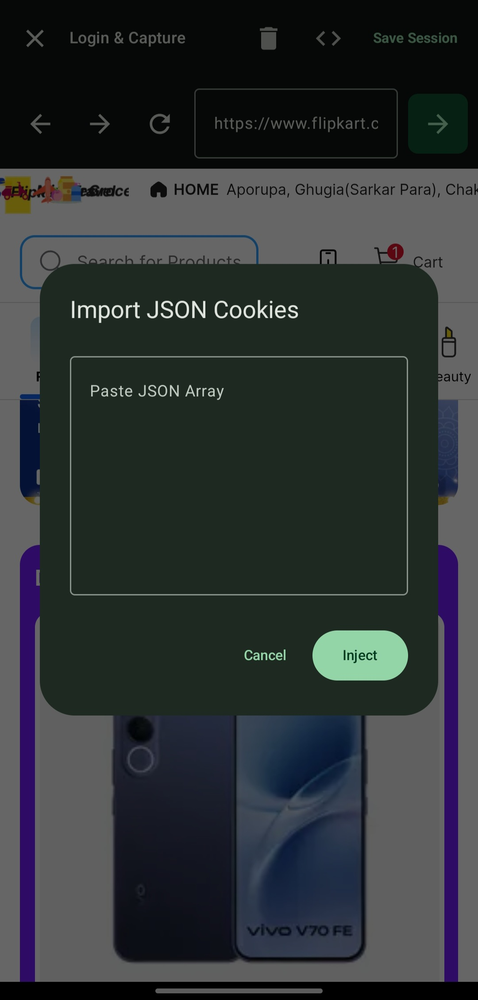<br>
Paste a cookie JSON array exported from a desktop browser to start an authenticated session without automating the login.

### 9. Authenticated Hidden WebView
<br>
The result of session import: a persistent, logged-in WebView session ready for background extraction.

### 10. Extraction History Log
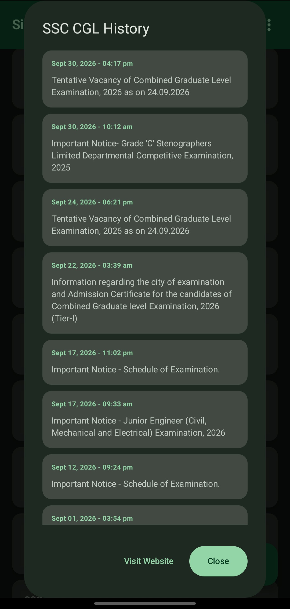<br>
Chronological history of detected changes per monitor, with timestamps and a link back to the page.

### 11. Android Notifications
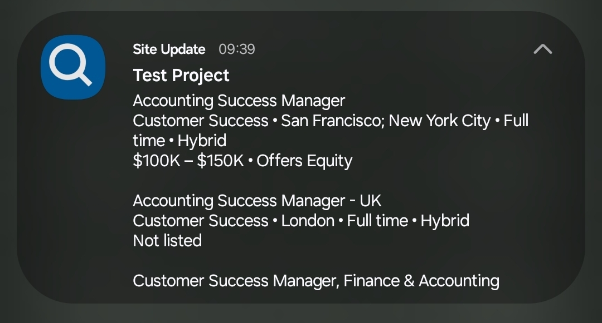<br>
The end-user output: a native notification containing the formatted extracted value.

### 12. Webhook / API Configuration
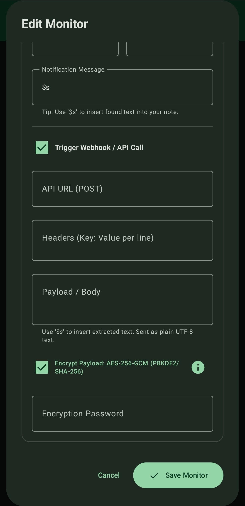<br>
API URL, multi-line headers, body template with `$s`, and the **Encrypt Payload** option.

### 13. In-App Decryption Guides
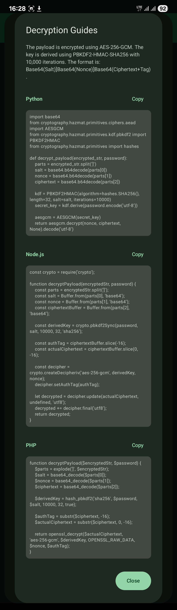<br>
Format description and copy-ready decryption code for Python, Node.js, and PHP, so a backend can be wired up quickly.

---

## 🧩 Custom JavaScript Guide

The JavaScript rule runs inside the loaded page. The **last evaluated expression is the result**, and it should be a string.

### Conventions

- **Return a string.** It becomes `$s` in the notification, the log entry, and the webhook body.
- **Return an empty string for "nothing to report"**, which simply produces no alert.
- **Handle failures inside the script.** Because every site is different, the script decides what counts as a problem and what the alert should say (for example `'Layout changed: tracker container not found'`). The app does not impose a generic error policy.
- Normalize whitespace yourself when needed (`.replace(/\s+/g, ' ').trim()`).

### Example: latest delivery milestone from a tracking page

```javascript
var tempElement = document.querySelector('#progressTracker-container');

var outputstring = tempElement
    ? [...tempElement.querySelectorAll('.milestone')]
        .reverse()
        .map(el => {
            var status = el.querySelector('.milestone-primaryMessage')?.innerText
                .replace(/\s+/g, ' ').trim() || '';

            var details = el.querySelector('.milestone-explanation')?.innerText
                .replace(/\s+/g, ' ').trim() || '';

            return details ? `${status} - ${details}` : '';
        })
        .find(text => text.includes(' - ')) || ''
    : '';

outputstring;
```

> This is an illustration of the technique. Class names on third-party sites change, so selectors in examples may need updating.

### Example: explicit "layout changed" reporting

```javascript
var box = document.querySelector('#results');
if (!box) {
    'Layout changed: #results not found';
} else {
    box.innerText.replace(/\s+/g, ' ').trim();
}
```

---

## 🔌 Backend Integration (Webhook + Encryption)

### Request shape

```
POST https://your-server.example/events
Content-Type: text/plain; charset=utf-8
Authorization: Bearer <token>
X-Monitor: Amazon Tracking

<body: extracted text, or the encrypted string when Encrypt Payload is on>
```

Keep header values ASCII-only. Put free-form text in the body.

### Decryption snippets

<details>
<summary><b>Python</b></summary>

```python
import base64
from cryptography.hazmat.primitives.ciphers.aead import AESGCM
from cryptography.hazmat.primitives.kdf.pbkdf2 import PBKDF2HMAC
from cryptography.hazmat.primitives import hashes

def decrypt_payload(encrypted_str, password):
    parts = encrypted_str.strip().split(']')
    if len(parts) != 3:
        raise ValueError("unexpected payload format")
    salt = base64.b64decode(parts[0])
    nonce = base64.b64decode(parts[1])
    ciphertext = base64.b64decode(parts[2])  # includes the 16-byte tag

    kdf = PBKDF2HMAC(algorithm=hashes.SHA256(), length=32, salt=salt, iterations=10000)
    secret_key = kdf.derive(password.encode('utf-8'))

    return AESGCM(secret_key).decrypt(nonce, ciphertext, None).decode('utf-8')
```
</details>

<details>
<summary><b>Node.js</b></summary>

```javascript
const crypto = require('crypto');

function decryptPayload(encryptedStr, password) {
    const parts = encryptedStr.trim().split(']');
    const salt = Buffer.from(parts[0], 'base64');
    const nonce = Buffer.from(parts[1], 'base64');
    const ciphertextBuffer = Buffer.from(parts[2], 'base64');

    const derivedKey = crypto.pbkdf2Sync(password, salt, 10000, 32, 'sha256');

    const authTag = ciphertextBuffer.slice(-16);
    const actualCiphertext = ciphertextBuffer.slice(0, -16);

    const decipher = crypto.createDecipheriv('aes-256-gcm', derivedKey, nonce);
    decipher.setAuthTag(authTag);

    let decrypted = decipher.update(actualCiphertext, undefined, 'utf8');
    decrypted += decipher.final('utf8');
    return decrypted;
}
```
</details>

<details>
<summary><b>PHP</b></summary>

```php
function decryptPayload($encryptedStr, $password) {
    $parts = explode(']', trim($encryptedStr));
    $salt = base64_decode($parts[0]);
    $nonce = base64_decode($parts[1]);
    $ciphertext = base64_decode($parts[2]);

    $derivedKey = hash_pbkdf2('sha256', $password, $salt, 10000, 32, true);

    $authTag = substr($ciphertext, -16);
    $actualCiphertext = substr($ciphertext, 0, -16);

    return openssl_decrypt($actualCiphertext, 'aes-256-gcm', $derivedKey,
                           OPENSSL_RAW_DATA, $nonce, $authTag);
}
```
</details>

### Example receiver: FastAPI + PostgreSQL

A minimal reference implementation that accepts the webhook, decrypts, and stores each event.

```sql
CREATE TABLE monitor_events (
    id          BIGSERIAL PRIMARY KEY,
    monitor     TEXT        NOT NULL,
    value       TEXT        NOT NULL,
    received_at TIMESTAMPTZ NOT NULL DEFAULT now()
);
```

```python
import os
import psycopg
from fastapi import FastAPI, Request, Header, HTTPException

app = FastAPI()
PASSWORD = os.environ["PAYLOAD_PASSPHRASE"]
DSN = os.environ["DATABASE_URL"]

@app.post("/events")
async def ingest(request: Request, x_monitor: str = Header(default="unknown")):
    body = (await request.body()).decode("utf-8").strip()
    try:
        text = decrypt_payload(body, PASSWORD)   # from the Python snippet above
    except Exception:
        raise HTTPException(status_code=400, detail="decryption failed")

    text = text.replace("\x00", "")              # PostgreSQL text cannot store NUL
    with psycopg.connect(DSN) as conn:
        conn.execute(
            "INSERT INTO monitor_events (monitor, value) VALUES (%s, %s)",
            (x_monitor, text),
        )
    return {"status": "ok"}
```

Receiver checklist: read the **raw** body (do not parse as JSON), trim whitespace before splitting, validate there are three parts, and treat decryption failure as a normal 400 response.

---

## 📄 Log Export Format

The text export is human-readable and consistent, so a single parser works for every file.

```
=== Log Export for Amazon Tracking ===
URL: https://amzn.eu/d/00Vr6s2L

[Oct 21, 2026 - 03:41 pm]
Package arrived at an Amazon facility at Prayagraj, Uttar Pradesh at 4:15 am Wednesday, 21 October

--------------------------------------------------
```

Each entry starts with a `[timestamp]` line, followed by the extracted value, followed by a dashed separator. If the format ever changes, a version marker will be added to the header so parsers can tell the formats apart; files without one are the original format.

<details>
<summary><b>Parse it with Python</b></summary>

```python
import re

text = open("export.txt", encoding="utf-8").read()
entries = re.findall(r"^\[(.+?)\]\n(.*?)(?=^\[|\Z)", text, re.S | re.M)
rows = [(ts, val.replace("-" * 50, "").strip()) for ts, val in entries]
```
</details>

---

## 🔒 Security Model

| Asset | Protection |
|---|---|
| Webhook payload | Optional AES-256-GCM with a PBKDF2-derived key; tampering is detected by the authentication tag |
| Transport | Intended to be used over HTTPS, which also protects headers such as API tokens |
| Backup file | Password-protected, encrypted export; import requires the exact password |
| Log export | Plain text by design; encrypt separately before sharing if it contains sensitive values |
| Session cookies | Imported by the user for their own accounts and used only by the app's WebView |

Notes:

- The encryption passphrase is shared between the app and the receiver; keep it out of source control and load it from an environment variable or secret store on the server.
- Treat exports and backups like any file that may contain API URLs, tokens, and extracted data.

---

## 🧠 Design Decisions

- **Selectors over screen positions.** Targets are described by *what the element is* (CSS/XPath/keyword), not where it appears, so extraction survives layout shifts.
- **Strict time waits over "wait until visible".** If a target element has been removed from a page, a visibility wait could hang forever. Fixed waits give every run a known maximum duration, which matters for a battery-conscious background job.
- **Failure handling lives in the script.** Different monitors need different definitions of failure (some do not care about outages at all). Letting each JavaScript routine return its own message avoids forcing hard-coded "site unavailable" alerts on every monitor.
- **Plain-text webhook body.** Sending raw UTF-8 text avoids escaping problems entirely; no character in scraped content can invalidate the body.
- **Raw text log export.** Logs are not always tabular; exporting text and shaping it with JavaScript or downstream scripts keeps the app flexible.
- **Local-first.** Scheduling, rendering, extraction, and storage all happen on the device; no cloud service is required.

---

## ⚠️ Known Limitations

- **Selector dependence.** Extraction depends on the target site's markup. If a site restructures its page, the selector or script must be updated.
- **Polling, not push.** Updates are detected on the configured interval; there is no real-time subscription.
- **Android background scheduling.** Timing can be affected by device battery optimization and vendor-specific restrictions, so very short intervals are not guaranteed.
- **Login-protected sites** rely on a valid imported session; sessions expire and must be refreshed.
- **Third-party sites may restrict automated access.** Behavior depends on each site's own policies and defenses.

---

## 🤝 Responsible Use

This tool is built for **personal monitoring of information you are entitled to see**, such as your own parcels, public notices, and prices.

- Respect each website's terms of service and `robots.txt`.
- Use reasonable intervals; do not hammer servers.
- Use session import only with **your own** accounts.
- Do not use the tool to circumvent access controls or to collect data you are not permitted to access.

---

## 🗺️ Roadmap

Ideas under consideration:

- **Send test payload** button to verify URL, headers, and decryption in one step
- Versioned payload header (including the key-derivation iteration count) for future-proof decryption
- **JSON Lines** log export for direct database ingestion
- Retry queue for webhook deliveries that fail while offline
- "Simple" vs "Advanced" configuration modes to shorten the form for basic selector monitors
- Per-step failure messages for click sequences ("step 2: element not found")

---

## 🛠️ Engineering Workflow & Role

**Role:** Product and system design, feature specification, data flow, and orchestration logic.

**Approach:** The feature set comes directly from problems encountered while scraping and monitoring real sites. The system behavior (extraction modes, timing model, change detection, webhook and encryption design, backup format) was specified and tested by me; AI-assisted workflows were used to accelerate the native Android implementation.

**Testing:** Features were verified on a physical device against live sites, including webhook delivery, payload encryption and decryption, encrypted backup round-trips, and log export.

---

## 📬 Source Code & Contact

The source code is currently **private**. This repository documents the architecture, features, and integration formats.

I am happy to provide a **live technical walkthrough** of the Android background services, extraction engine, and encryption design over a screen share.

- **Name:** Soumyadip Ghosh
- **Email:** dev.sam.here@gmail.com
- **LinkedIn:** www.linkedin.com/in/SamDip
- **GitHub:** https://github.com/rotten-repo
